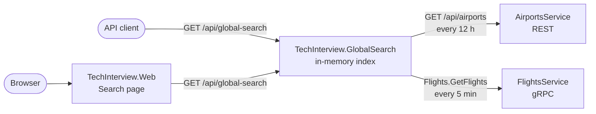

# Global Search – Architecture

`TechInterview.GlobalSearch` is a dedicated microservice that answers `GET /api/global-search` from an
**in-memory index**, refreshed in the background from the existing Airports (REST) and Flights (gRPC)
services. The existing services are not modified.

Possible evolution with a persistent store: [`evolution-architecture.md`](evolution-architecture.md).

## Components

## Why an in-memory index

The source services have no search API: they only return pages of at most 100 items, with an artificial
delay of `100 ms + 50 ms × limit` per call. Reading every flight at each search would take from 5 to 50 seconds.
The search service therefore keeps a local copy of the data (about 1,100 documents) and never calls the sources
while answering a request. A linear scan over so few documents takes microseconds, so no inverted index is needed.

The trade-off is eventual consistency: results can be up to one refresh interval old (5 minutes for flights,
12 hours for airports).

## Loading the index

Each domain has its own background refresh:

1. a probe with `limit = 1` reads the total count (about 0.15 s);
2. all pages are then fetched in parallel, 10 at a time, and the last page asks only for the remaining items:
   a full load takes about 5 seconds instead of 50;
3. if the unique ids read do not match the total count, the source changed while paging and the load is discarded;
4. the new documents replace the old ones with an atomic swap, so a search never sees a half-loaded index.

If a load fails, the previous index stays in use and the load is retried after 30 seconds. Until both domains
have been loaded once, `/health` reports Unhealthy and the API answers 503.

## Search

- **Normalization**: query and data are trimmed, stripped of diacritics and uppercased with the invariant culture
  (`münchen` → `MUNCHEN`), then compared ordinally. This also avoids the Turkish-I problem on codes such as `IST`.
- **Validation**: the normalized query must have at least 3 characters, otherwise 400. `limit` defaults to 10 and is
  capped at 100, like in the existing services.
- **Ranking**: exact match > prefix (of a field or of a word) > contains. Within the same level, codes rank above
  names and cities, then the airport codes of a flight, then the country. Ties: airports first, then flights by
  departure time, then id.
- **Paging**: `offset` and `limit` are applied after ranking the merged airports and flights.
- **Response**: `count` is the number of items in the page, as in the README example. `totalCount` is the total
  number of matches, the same name used by the existing services.

## Aspire and Web

- The AppHost starts `globalsearch` after both services; it becomes healthy after the first full load.
- `webfrontend` references `globalsearch` without waiting for it: while the search service is starting, only
  the Search page is affected.
- The Search page keeps query and page in the URL, and links every result to the airport or flight detail page.

